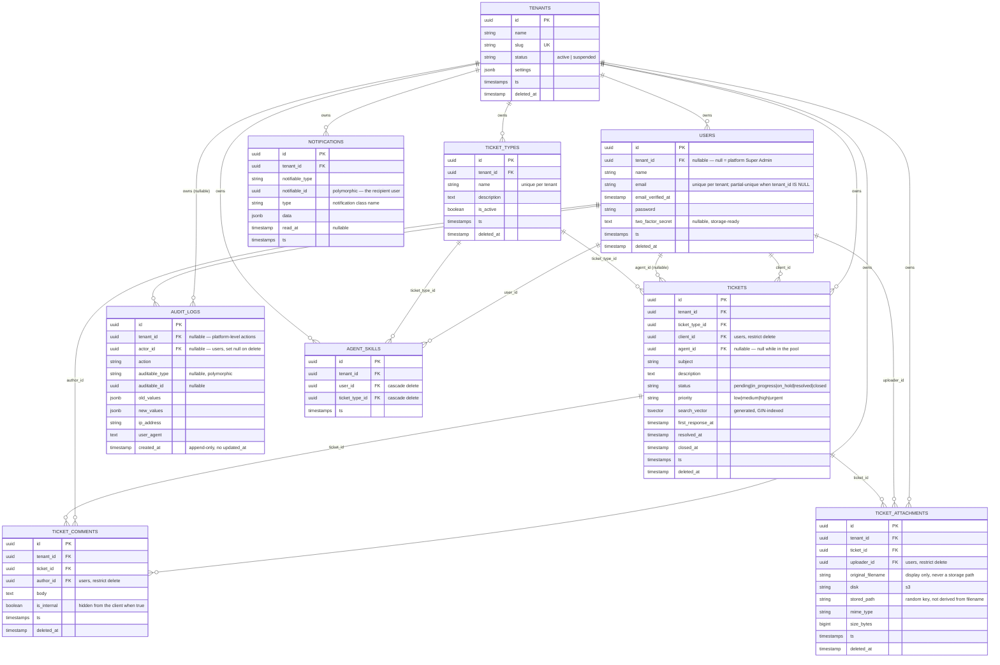

# Entity-Relationship Diagram

Every table below except `tenants` itself carries a `tenant_id` and is
protected by PostgreSQL Row-Level Security (see
[`architecture.md`](architecture.md#multi-tenancy-shared-schema--postgresql-row-level-security)).
Spatie `laravel-permission`'s pivot tables are omitted for readability — see
`database/migrations/0001_01_01_000003_create_permission_tables.php` for
their exact shape (`teams`-mode, `tenant_id` as the team foreign key).

## Notes on deliberate design choices

- **UUID primary keys everywhere** — no auto-increment integer IDs, so
  resource identifiers never leak cross-tenant row counts and are safe to
  expose directly in URLs/API responses.
- **`agent_id` nullable, `client_id` not** — a ticket always has a client
  (who reported it) but may sit unassigned in the pool with no agent yet.
- **`restrictOnDelete()` on `client_id`/`author_id`/`uploader_id`** — a user
  who has ever created a ticket, posted a comment, or uploaded a file cannot
  be hard-deleted while that history exists (soft-delete the user instead);
  `agent_id` is `nullOnDelete()` since unassigning a ticket when its agent
  leaves is a valid, non-destructive outcome.
- **`tickets.search_vector`** is a stored generated column, not a
  separately-maintained field — it can never drift out of sync with
  `subject`/`description` because Postgres recomputes it on every write.
- **`notifications.tenant_id` is `NOT NULL`** (unlike `audit_logs`) —
  notifications are always about something tenant-scoped (a ticket event);
  there is no platform-level notification concept yet.
- **`agent_skills` is a plain many-to-many pivot with its own `tenant_id`**
  (not derivable from either side alone in a way RLS could use directly) —
  it exists solely to drive the ticket pool's skill-based filtering (see
  `architecture.md`); a missing row means "not qualified", not "qualified
  for everything" — the pool fails closed for a fresh agent with no rows
  here yet, same as every other RLS/permission boundary in this app.
